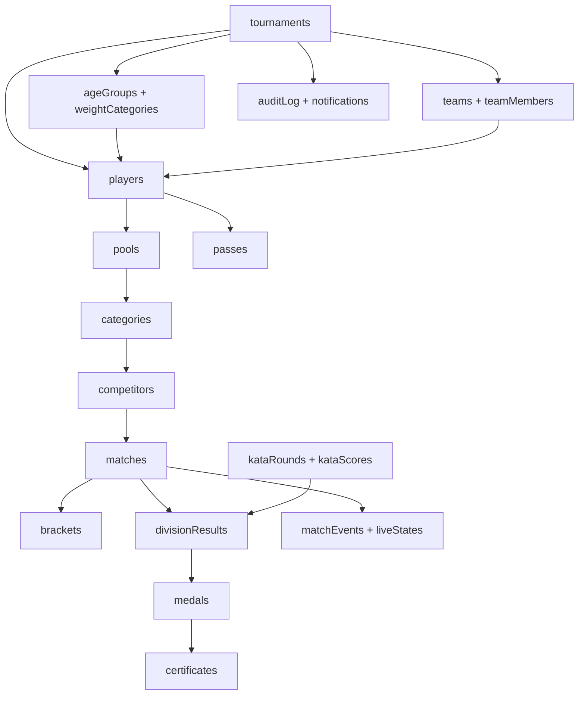

# API structure and data effects

This is a code-oriented map of the API: where requests enter, which route handles each task, how callers authenticate, and which MongoDB collections are read or changed. It describes the implementation under `packages/api` and `packages/shared`; the route list is the server surface, while the web wrappers show how the app calls it.

## 1. At a glance

The API is an Express 5 and Socket.IO service. REST endpoints use `/api/v1`; `/health` is the only HTTP route outside that versioned prefix. The frontend is configured with `VITE_SERVER_URL` and calls the API through its data adapters.

```text
React app
  ├─ data/domain.js ───────────────────┐
  ├─ data/tms/api.js ──────────────────┤ HTTP /api/v1
  └─ data/channel/socket.js ───────────┤ Socket.IO
                                       ▼
packages/api/index.js
  ├─ middleware: body size, security/CORS, rate limit, idempotency
  ├─ routes: auth, users, tournaments, TMS, coach, public, scoring, etc.
  ├─ auth/*: JWT identity, session checks, role and tournament scope
  ├─ @kumite/shared/tms.js: tournament workflows and business rules
  ├─ @kumite/shared/commands.js: authoritative live-bout reducer
  └─ lib/store.js ── MongoDB Atlas when MONGODB_URI is set; otherwise memory
```

`@kumite/shared` contains the tournament domain service, permission table, lifecycle rules, kata/pool/result logic, query helpers, and the live scoring reducer. Routes validate HTTP inputs and check access; they pass domain operations to the shared service rather than implementing tournament rules a second time. The legacy category, competitor, and match routes use stores more directly.

The web-side API wrappers are [domain.js](../packages/web/src/data/domain.js), [tms/api.js](../packages/web/src/data/tms/api.js), and [socket.js](../packages/web/src/data/channel/socket.js). Server mounting, shared middleware, and Socket.IO handlers are in [index.js](../packages/api/index.js).

## 2. Calling conventions

### HTTP requests

- JSON REST base: `http(s)://<api-origin>/api/v1`.
- Authenticated requests use `Authorization: Bearer <JWT>`. Coach portal requests use a coach JWT obtained from the public registration-link session endpoint or a coach account login.
- Write retries can send `Idempotency-Key: <unique-key>`. For authenticated `POST`, `PUT`, and `PATCH` requests the process caches the first response for ten minutes, scoped to token, method, URL, and key. A concurrent retry returns `409 request_in_progress`. This cache is in memory and does not coordinate across API instances.
- List endpoints that support paging generally accept `page` (1-based), `limit` (capped by the shared pagination reader), and sometimes `q`. Responses include `page`, `limit`, `pages`, and `total`. The web adapters sometimes walk pages to build a full export/list.
- Successful single-record responses commonly wrap a key such as `{ tournament }`, `{ player }`, or `{ match }`; list responses use `{ players }`, `{ matches }`, etc. Deletes commonly return `204` with no body. PDF routes return `application/pdf` attachments.
- Expected errors use `{ "error": "machine_code", "details": ... }`. Domain and API errors preserve their status; malformed JSON is `400 invalid_json`, oversized payloads are `413 payload_too_large`, unmatched paths are `404 route_not_found`, and unhandled failures return `500 internal_error`.

### Shared request protections

`index.js` applies JSON limits (32 KB normally, 2 MB on bulk player imports, 4 MB on file upload), security headers and CORS, API rate limits, and idempotency before the route groups. Defaults are 1,200 API requests/minute and 6,000 public/display reads/minute; environment settings can override them. Login, password reset, partner import, and coach-link attempts have additional route-specific limits. `TRUST_PROXY` controls whether forwarded client addresses are trusted. The current CORS allow-header list is `content-type`, `authorization`, and `idempotency-key`; browser-based cross-origin calls to the partner route also need `x-api-key` allowed, while server-to-server requests are unaffected.

### Access model

Most signed-in routes resolve the caller's role for the target tournament, then check a shared permission such as `registration.view`, `match.call`, or `result.publish`. `tournamentAccess` also limits which tournament IDs the account can reach (organization, assignment, or global admin access). A user's tournament-specific role can override their account-wide role inside one event. A coach is restricted to the single tournament/team represented by their token.

The role/permission source of truth is [permissions.js](../packages/shared/permissions.js). The server enforces permissions even if the frontend hides the relevant button. The broad role intent is:

| Role | Typical API access |
| --- | --- |
| `super_admin` | Every permission, across organisations |
| `admin` | Every permission, rulesets and backups included, within its organisation. The same set as `super_admin`: the two differ in scope, not in what they may do |
| `tournament_owner` | Tournament administration within assigned events |
| `registration_officer` | View/manage registration and edit players |
| `weighin_officer` | View registration and record weigh-ins |
| `referee` | Score and control permitted bouts; public tournament view |
| `judge` | Kata scoring on assigned rounds; read-only access to other match state |
| `announcer` | Call matches and mark attendance |
| `scoreboard_operator` | Control public display content |
| `viewer` | Read tournament lists and reports |
| `coach` | Team registration portal only |

## 3. HTTP endpoint inventory

The tables below use the `/api/v1` prefix implicitly. `:tid` is a tournament ID, `:id` is the record ID named by the route, and `:divisionKey` identifies an event/age/weight division. `Read/write collections` names the persistent collections; a GET may calculate a response from several collections without changing them.

### Health and account access

| Endpoint | Task and typical use | Collections affected |
| --- | --- | --- |
| `GET /health` | Uptime probe. Returns server time, storage mode (`mongodb` or `memory`), and uptime. | None |
| `POST /auth/login` | Verify email/password and optional TOTP; returns JWT and user. Creates a session and logs the attempt asynchronously. | Reads `users`; writes `sessions`, `loginEvents`; failed-login audit may write `auditLog`. |
| `GET /auth/test-credentials` | The bootstrap administrator's address and password, for the sign-in screen to offer while testing. Answers `{ credentials: null }` unless `SHOW_TEST_CREDENTIALS` is exactly `true`. | Reads neither collection: it echoes the two environment variables, since a stored password is a hash. |
| `POST /auth/forgot` | Request a password reset; response intentionally does not reveal whether the email exists. Sends email when the account exists. | Reads `users`; writes `passwordResets`. |
| `POST /auth/reset` | Redeem reset token and set a new password. | Reads/deletes `passwordResets`; updates `users`. |
| `POST /auth/2fa/setup`, `/auth/2fa/enable`, `/auth/2fa/disable` | Create a pending TOTP secret, confirm it, or disable TOTP for the signed-in account. | Updates `users`. |
| `GET /auth/account`, `GET /auth/me` | Read current account/security summary or the current signed-in identity and current role claims. | Reads `users` (the JWT supplies the base identity). |
| `POST /auth/logout` | Revoke the current session and record sign-out. | Updates `sessions`; writes `auditLog`. |
| `GET /auth/sessions`, `DELETE /auth/sessions/:sid`, `POST /auth/sessions/revoke-others` | List or revoke the caller's active sessions. | Reads/updates `sessions`; revocation writes `auditLog`. |
| `GET /auth/logins` | Admin-only, paged sign-in history; optional `email` and `outcome` filters. | Reads `loginEvents`. |

### Accounts, organisations, rulesets, and system tools

| Endpoint | Task and typical use | Collections affected |
| --- | --- | --- |
| `GET /users` | Admin account picker/list; supports `page`, `limit`, `q`, and organization scope. | Reads `users`. |
| `POST /users`, `PATCH /users/:uid`, `DELETE /users/:uid` | Admin creates, edits, or removes accounts/roles. Organization admins are scoped; super admins can manage global assignments. Account changes are audited. | Writes `users`, `auditLog`; checks `matches` before changing/removing assigned officials. |
| `GET /organizations` | Read the super-admin organization directory with account/tournament counts. | Reads `users`, `organizations`, `tournaments`. |
| `POST /organizations`, `PATCH /organizations/:id`, `DELETE /organizations/:id` | Super admin manages organizations. Delete is refused while accounts or tournaments still reference it. | Writes `organizations`, `auditLog`; reads `users`, `tournaments`. |
| `GET /rulesets?all=1` | Staff lists active rulesets; `all=1` includes superseded versions. Coaches are excluded. | Reads `rulesets`. |
| `POST /rulesets`, `PATCH /rulesets/:id`, `POST /rulesets/:id/restore`, `POST /rulesets/:id/active` | Ruleset manager creates a ruleset, versions edits, restores a built-in baseline, or changes active status. | Writes `rulesets`, `auditLog`; update checks `tournaments` using the ruleset. |
| `GET /system/audit` | System-level audit feed for account/org/ruleset changes, deletions, backups, and other system audit events; paged and searchable. | Reads `auditLog` where `tournamentId` is null. Sign-in attempt records are read separately through `GET /auth/logins` from `loginEvents`. |
| `GET /system/backup` | Download JSON for the application stores and user accounts; the download itself is audited. | Reads stores and `users`; writes system `auditLog`. It does not include the separate auth collections `sessions`, `passwordResets`, or `loginEvents`. |
| `GET /analytics` | Cross-tournament athletes/clubs/results analytics for events the caller may access. | Reads `tournaments`, `players`, `teams`, `matches`, `medals`. |
| `GET /officials?role=...` | Populate referee/judge/administrator picker without exposing account-management fields. Scoped to the caller's organization. | Reads `users`. |

### Tournament records and legacy scoring structure

These endpoints support the original kata/kumite scoring model. Categories own competitors and matches. The TMS draw workflow also creates these rows so the scoring console can consume generated divisions.

| Endpoint | Task and typical use | Collections affected |
| --- | --- | --- |
| `GET /tournaments`, `GET /tournaments/:id` | List tournaments visible to the caller or load one tournament. Lists are paged/searchable. | Reads `tournaments`; list scoping may read `users`/`organizations`. |
| `POST /tournaments` | Admin creates a tournament and assigns it to their organization (or the organization supplied by a super admin). | Writes `tournaments`; validates `organizations`. |
| `PATCH /tournaments/:id` | Tournament admin edits tournament details. Master-age-date changes are passed through the TMS service because player ages may need recalculation. | Writes `tournaments` and `auditLog`; a confirmed date change may also update `players`. |
| `DELETE /tournaments/:id` | Admin deletes a non-live tournament and its descendants; coach accounts for that tournament are removed. | Deletes tournament-owned rows from `ageGroups`, `weightCategories`, `teams`, `teamMembers`, `players`, `pools`, `brackets`, `medals`, `certificates`, `registrationLinks`, `notifications`, `files`, `kataRounds`, `kataScores`, `medalOverrides`, `matchEvents`, `divisionResults`, `passes`, and `apiKeys`; also removes category-owned `competitors`/`matches`, tournament `categories`, matching coach `users`, and the `tournaments` row. It removes matching `liveStates` by match ID and writes a system `auditLog` row. The purge helper does not delete existing tournament `auditLog` rows or `display` rows. |
| `GET /tournaments/:tournamentId/categories` | Page/search categories by name, age group, or division. | Reads `tournaments`, `categories`. |
| `POST /tournaments/:tournamentId/categories` | Create a manually managed category. Draw-managed categories cannot be manually created. | Writes `categories`; reads `tournaments`. |
| `GET /categories/:id`, `PATCH /categories/:id`, `DELETE /categories/:id` | Read/edit/delete one category. A category with completed results cannot be deleted; deletion cascades to its competitors and matches. | Reads/writes `categories`; delete also removes `competitors`, `matches`; patch/delete write `auditLog`. |
| `GET /categories/:categoryId/competitors` | Page/search the entrants for a category. | Reads `categories`, `competitors`. |
| `POST /categories/:categoryId/competitors` | Add a manually managed entrant. Draw-managed entrants come from registration. | Writes `competitors`; reads `categories`. |
| `GET /competitors/:id`, `PATCH /competitors/:id`, `DELETE /competitors/:id` | Read/edit/delete one entrant; deletion is refused if the entrant has a completed bout. | Reads/writes `competitors`; deletion also reads `matches`. |
| `GET /categories/:categoryId/matches`, `GET /matches` | List matches by category or across accessible tournaments. The flat list can filter/paginate and restricts officials to assigned/unassigned work unless `all=1`. | Reads `matches`, `categories`, `tournaments`, and for authorization `users`. |
| `POST /categories/:categoryId/matches` | Create one match with competitors, officials, schedule, mat, and initial status. The server validates participants, panel size, and schedule conflicts. | Writes `matches`; reads `competitors`, `categories`, `tournaments`, `users`. |
| `POST /categories/:categoryId/matches/draw` | Generate missing round-robin pairings (up to 32 competitors); repeated calls only add missing pairings. | Reads `categories`, `competitors`, `matches`; inserts `matches`. |
| `GET /matches/:id`, `PATCH /matches/:id`, `DELETE /matches/:id` | Read/edit/delete one match. Patches check result corrections, role assignment, schedule clashes, and match authority. | Reads/writes `matches`; reads `competitors`, `categories`, `tournaments`, `users`; scoring corrections are audited. |

The legacy match routes accept schedule and result fields such as `redId`, `blueId`, `scheduledAt`, `mat`, `refereeId`, `judgeIds`, `winner`, and score averages. The server derives `endsAt` from tournament slot duration. It rejects overlapping use of a mat, official, or competitor with `409 schedule_conflict` and conflict details.

### Tournament management and registration

Most endpoints in this section are under `/tournaments/:tid`. They use the shared TMS service, which checks tournament lifecycle/locks, validates domain transitions, and records audit events for audited changes.

| Endpoint | Task and typical use | Collections affected |
| --- | --- | --- |
| `PATCH /tournaments/:tid/settings` | Change scoring, draw, fee, notification, visibility, certificate, attendance, or kata settings. | Writes `tournaments`; may write `auditLog`. |
| `POST /tournaments/:tid/lifecycle` | Move the tournament through its lifecycle (draft, registration, verification, weigh-in, draw, ready, live, completed, archived, etc.). Body includes target `to` and, where required, `reason`. | Writes `tournaments` and `auditLog`; locking entry states may update `players`, and completion can update `divisionResults`. |
| `POST /tournaments/:tid/locks/:which` | Set/unset `entries`, `soft`, `draw`, or `weighin` locks with a reason where required. | Writes `tournaments` and `auditLog`; entry lock/unlock may update many `players`; draw lock reads `pools`/kata divisions and may write `notifications`; weigh-in lock records close/reopen time. |
| `GET/POST/DELETE /tournaments/:tid/partner-key` | View the key hint, issue/rotate a partner import key (raw key is returned once), or revoke it. | Reads/writes `apiKeys`; stores only a SHA-256 hash and last-four-character hint; writes `auditLog`. |
| `GET /tournaments/:tid/registration-window` | Return whether registration is open under tournament dates, time zone, and entry/soft-lock settings. | Reads `tournaments`. |
| `POST /tournaments/:tid/master-date/preview` | Preview age/category impact of a proposed master-age date before applying it. | Reads `tournaments`, `players`, age/category configuration. |
| `POST /tournaments/:tid/ruleset` | Apply a versioned ruleset to a tournament. | Reads `rulesets`; writes `tournaments`, `auditLog`. |
| `PUT /tournaments/:tid/registration-form` | Configure the custom registration fields used when officials/coaches enter players. | Writes `tournaments`, `auditLog`. |
| `GET/POST/PATCH/DELETE /tournaments/:tid/age-groups` | Configure age groups and their inherited/category settings. | Reads/writes `ageGroups`; deleting a group cascades to its `weightCategories`; audit. |
| `GET/POST/PATCH/DELETE /tournaments/:tid/weight-categories` | Configure weight bands within an age group. | Reads/writes `weightCategories`; reads `ageGroups`; audit. |
| `POST /tournaments/:tid/category-presets` | Add a standard age-group/weight-category set in one operation. | Writes `ageGroups`, `weightCategories`, `auditLog`. |
| `GET/POST/PATCH/DELETE /tournaments/:tid/teams` | Manage clubs/teams and contact details. Deleting a non-empty team requires `?reason=`; its players and team members are removed by the service. | Reads/writes `teams`; team deletion also removes related `players`, `teamMembers`; audit. |
| `GET/POST/PATCH/DELETE /tournaments/:tid/team-members` | Manage managers, coaches, judges, and referees attached to a team. `GET` can filter by `teamId`. | Reads/writes `teamMembers`; reads `teams`; audit. |
| `GET/POST/PATCH/DELETE /tournaments/:tid/players` | List/filter/paginate registered players or create/edit/remove a player. Filters include team, gender, event, registration/payment/weigh-in status, age group, weight category, geography, and text query. | Reads/writes `players`; depending on validation, also `teams`, `ageGroups`, `weightCategories`, `pools`, `tournaments`; audit/notifications may be written. |
| `POST /tournaments/:tid/players/bulk/preview`, `POST /tournaments/:tid/players/bulk` | Preview CSV import problems/duplicates, then import rows. Preview is read-only; bulk create can link a team and report rejected rows. | Preview reads `players`, `teams`, form/config; import writes `players` and may create/read `teams`; audit/notifications. |
| `POST /tournaments/:tid/players/:id/registration` | Advance/return a registration through submit, approve, reject, send-back, or related workflow states. | Writes `players`; may write `notifications`, `auditLog`. |
| `POST /tournaments/:tid/players/:id/withdraw` | Withdraw an entrant with a reason after entry/draw; removes eligible future participation and records history. | Writes `players`; may update `matches`, `kataRounds`, and knockout progression in `matches`; reads `kataScores`; writes `auditLog`/`notifications`. |
| `PUT /tournaments/:tid/players/:id/payment` | Record payment status/reference/amount for the player. This is a manual payment record; no payment gateway callback is mounted here. | Writes `players`, `auditLog`, and payment notifications in `notifications`. |
| `POST /tournaments/:tid/players/:id/weigh-in` | Record weight/check result, recheck, category move, or override according to permission and rules. | Writes `players` and `auditLog`; may change draw eligibility and category assignment. |
| `PUT /tournaments/:tid/players/:id/entries/:event` | Add/change one event entry or its age/weight category, with reason where an override is needed. | Writes `players`; reads category config and `pools`; audit. |
| `POST /tournaments/:tid/categorize` | Calculate age/weight/event categories for eligible players, applying configured rules. | Reads `players`, `ageGroups`, `weightCategories`, `tournaments`; updates `players`; audit. |
| `GET /tournaments/:tid/divisions` | Read calculated divisions grouped from entries. | Reads `players`, `ageGroups`, `weightCategories`, `tournaments`, and existing `pools`/legacy bridge records. |

### Draw, bout scheduling, live status, and kata scoring

| Endpoint | Task and typical use | Collections affected |
| --- | --- | --- |
| `GET /tournaments/:tid/pools` | Inspect generated pools and their entrants/qualifiers. | Reads `pools`, `players`, `tournaments`. |
| `POST /tournaments/:tid/pools/generate` | Generate or regenerate pools for eligible divisions; accepts draw options and can target a division. | Reads `players`, category settings, existing `pools`, `categories`, `matches`; writes `pools`, `players`, `tournaments`, `auditLog`; may remove/rebuild bridge rows if allowed. |
| `GET /tournaments/:tid/draw/impact?divisionKey=...` | Preview what regeneration changes and whether it is safe. | Reads `pools`, `categories`, `competitors`, `matches`, `brackets`, `players`. |
| `POST /tournaments/:tid/pools/move` | Move a player between pools with a reason. | Writes `pools`, `auditLog`; reads `players`. |
| `POST /tournaments/:tid/pools/:id/qualifiers` | Set a pool's advancing players (and reason when applicable). | Writes `pools`, `auditLog`; reads `players`. |
| `POST /tournaments/:tid/divisions/single-entry` | Decide whether a one-player division is awarded or marked no-competition. | Writes `medalOverrides` and `auditLog`; the computed result view reflects the decision. |
| `GET /tournaments/:tid/matches` | Read tournament matches, optionally filter by division/stage/status/mat/official; referees see assigned/open matches by default. | Reads `matches`, `categories`, `competitors`, `pools`, `players`. |
| `POST /tournaments/:tid/matches/generate` | Create legacy categories, competitors, pool/knockout bouts, and their mapping from registration data. Can target one `divisionKey`. | Reads `players`, `teams`, `pools`, `tournaments`; writes `categories`, `competitors`, `matches`, `brackets`, and updates `pools`; audit. |
| `POST /tournaments/:tid/matches/:id/correct` | Correct a recorded result with a reason/authorized result-management permission. | Writes `matches`, `matchEvents`, and `auditLog`; may update downstream knockout `matches`. Division results/medals are computed from the corrected bout. |
| `POST /tournaments/:tid/matches/:id/status` | Move a bout through supported non-final states such as called, ready, live, or paused. Completed/cancelled outcomes go through result entry/correction instead. Requires match-score or match-call permission. | Writes `matches` and `auditLog`; public change notification may follow. |
| `POST /tournaments/:tid/matches/:id/attendance` | Mark AKA/AO present or absent. | Writes `matches`, `auditLog`. |
| `POST /tournaments/:tid/running-event` | Select which event (kata or kumite) the mats are currently running. | Writes `tournaments`, `auditLog`, and a team-facing `notifications` event. |
| `POST /tournaments/:tid/matches/:id/call` | Call a bout to a mat and set its call/schedule state. | Writes `matches`, `auditLog`, and match-call `notifications`; reads `categories`, `competitors`, `tournaments`. |
| `GET /tournaments/:tid/matches/:id/events` | Read ordered live command history for an authorized audit viewer. | Reads `matchEvents`. |
| `POST /tournaments/:tid/matches/:id/swap-corners` | Swap AKA/AO (red/blue) assignments before a bout, with optional reason. | Writes `matches`, `auditLog`; reads `competitors`/`players`. |
| `GET /tournaments/:tid/kata/divisions` | List panel-kata divisions and rounds; judges only see rounds assigned to them. | Reads `kataRounds`, `kataScores`, `players`, `teams`, category settings. |
| `GET /tournaments/:tid/kata/judges` | List judges with assigned seats who may be placed on a panel. | Reads `users`. |
| `POST /tournaments/:tid/kata/rounds` | Create/start a panel round for a division with seed and judge-seat assignments. | Writes `kataRounds`; reads `players`, `teams`, `tournaments`, `users`; audit. |
| `GET /tournaments/:tid/kata/rounds/:id` | Read round details and computed scores/rankings. | Reads `kataRounds`, `kataScores`, `players`, `teams`. |
| `POST /tournaments/:tid/kata/rounds/:id/judges`, `/start` | Reassign judges/seats or open the scoring round. | Writes `kataRounds`; may read `kataScores` to protect submitted seats; audit. |
| `POST /tournaments/:tid/kata/rounds/:id/scores` | Submit or replace the caller's assigned-seat score for a performer. `submissionId` supports idempotent submission. | Writes `kataScores`; reads/writes `kataRounds`; audit. |
| `POST /tournaments/:tid/kata/rounds/:id/penalties` | Add/edit an official deduction with reason. | Writes `kataRounds`, `auditLog`. |
| `POST /tournaments/:tid/kata/rounds/:id/override` | Override a judge's score; requires the elevated result-override permission and a reason. | Writes `kataScores`, `auditLog`. |
| `POST /tournaments/:tid/kata/rounds/:id/complete` | Complete round and finalize its outcome. | Writes `kataRounds`; downstream result views are recalculated from round/scores. |

### Results, brackets, publication, reports, certificates, passes, and files

| Endpoint | Task and typical use | Collections affected |
| --- | --- | --- |
| `GET /tournaments/:tid/results` | Read computed division results and their verification/publication state. | Reads `tournaments`, `ageGroups`, `weightCategories`, `players`, `teams`, `pools`, `categories`, `competitors`, `matches`, `brackets`, `kataRounds`, `kataScores`, `divisionResults`, `medalOverrides`, and (for locked results) `medals`. |
| `POST /tournaments/:tid/results/medals/override` | Manually set/clear medal recipients; reason is mandatory. | Writes `medalOverrides`, `auditLog`; computed medal view uses `players` and division results. |
| `POST /tournaments/:tid/results/verify` | Verify/unverify one division's provisional result. | Writes `divisionResults`, `auditLog`; with automatic publishing enabled, it also writes `medals`, updates `tournaments`, and notifies teams through `notifications`. |
| `POST /tournaments/:tid/results/lock` | Lock a division's result or unlock it with required authority/reason. | Writes `divisionResults`, `auditLog`. |
| `GET /tournaments/:tid/brackets`, `GET /tournaments/:tid/bracket?divisionKey=...` | Read generated bracket summaries/details. | Reads `brackets`, `matches`, `competitors`, `players`. |
| `PUT /tournaments/:tid/bracket/layout` | Arrange entrants/bye slots before the bracket is fought. | Writes `brackets`; deletes existing knockout `matches` for that division before saving the layout; reads `competitors`; audit. |
| `POST /tournaments/:tid/brackets/generate` | Generate a knockout bracket for one division. | Writes `brackets`, `matches`; reads `pools`, `players`, `competitors`; audit. |
| `POST /tournaments/:tid/results/publish` | Publish or unpublish tournament results and materialized medal rows. | Writes `divisionResults`, `medals`, `tournaments`, `auditLog`; reads computed results. |
| `GET /tournaments/:tid/medals`, `GET /tournaments/:tid/medal-tally?by=club|district|state|country` | Read medal recipients or aggregate medal standings. | Reads `medals`, `players`, `teams`, `tournaments`. |
| `GET /tournaments/:tid/certificates?type=...` | List generated certificates for staff. | Reads `certificates`. |
| `POST /tournaments/:tid/certificates/generate`, `POST /tournaments/:tid/certificates/custom` | Generate medal/participation/coach/official certificates or issue one custom certificate. | Writes `certificates`; generation reads `medals`, `players`, `teams`, `pools`, `kataRounds`, `matches`, `users`; audit. |
| `GET /tournaments/:tid/certificates.pdf?type=...`, `GET /tournaments/:tid/certificates/:certificateId.pdf` | Download a PDF collection or single certificate. | Reads `tournaments`, `certificates`, optional logo from `files`; writes `auditLog` for downloads. |
| `GET /tournaments/:tid/reports/:key`, `GET /tournaments/:tid/reports/:key.pdf` | Return report rows or download a server-built PDF. Only known report keys are accepted; audit report also requires audit access. | Reads the relevant tournament collections, including `auditLog` for audit reports; PDF export writes `auditLog`. |
| `POST /tournaments/:tid/exports` | Record a browser-generated CSV/XLSX/PDF export so it appears in audit history. | Writes `auditLog`. |
| `POST /tournaments/:tid/passes/generate`, `GET /tournaments/:tid/passes?kind=...`, `GET /tournaments/:tid/passes.pdf?kind=...` | Generate/list/download QR accreditation passes for players, coaches, and officials. PDF may embed uploaded player photos. | Writes/reads `passes`; generation reads `players`, `teams`, `users`; PDF reads `files`; export writes `auditLog`. |
| `POST /tournaments/:tid/checkin` | Scan a pass at arrival or mat. Body has `code` and optional `point` (`arrival` or `mat`). Permission varies by scan point. | Arrival updates `passes` and, for a player, `players`; mat check-in updates the next bout's `matches.attendance`. Both paths write `auditLog`. |
| `POST /tournaments/:tid/files` | Upload tournament logo, player photo, or document content (base64 JSON). Logo requires tournament-manage access. | Writes `files`. |
| `GET /files/:id` | Authenticated read of a file after ownership/visibility checks. | Reads `files`. |
| `GET /tournaments/:tid/registration-link`, `PUT /tournaments/:tid/registration-link` | Inspect or configure/disable/regenerate the public coach-registration link and optional password/expiry. | Reads/writes `registrationLinks`; writes `auditLog`. |
| `POST /tournaments/:tid/weigh-in/reminders` | Send configured reminders to entrants who still need weigh-in. | Reads `players`, `teams`, `tournaments`; writes `notifications`; may send email/SMS/WhatsApp through configured notifier gateways. |
| `GET /tournaments/:tid/dashboard` | Return tournament progress counters and workflow readiness. | Reads most event collections: `players`, `teams`, `teamMembers`, category config, pools, matches, results/medals, certificates, passes, kata rounds, registration link. |
| `GET /tournaments/:tid/notifications`, `POST /tournaments/:tid/notifications/read` | Read admin notifications or mark them read. | Reads/updates `notifications`. |
| `GET /tournaments/:tid/audit?page=...&q=...` | Read tournament audit trail, optionally paged/searched. | Reads `auditLog`. |

Supported report keys are `registration`, `player`, `team`, `category`, `weigh-in`, `pool`, `match`, `result`, `final-result`, `medal`, `medal-tally`, `payment`, `attendance`, `club`, and `audit`. The shared report builder accepts filters for gender, age group, division, club, district, state, and event.

### Public, coach, partner, and display APIs

| Endpoint | Task and typical use | Collections affected |
| --- | --- | --- |
| `GET /public/tournaments?org=...` | Public tournament directory, filtered by organization when requested. | Reads `tournaments`, `organizations`. |
| `GET /public/tournaments/:idOrSlug` | Read a public tournament page and published public-facing data according to visibility/settings. | Reads `tournaments`, `organizations`, and public result data such as `players`, `matches`, `medals`, `certificates`. Cached in process; writes none. |
| `GET /public/certificates/:certificateId` | Verify a certificate ID/QR. | Reads `certificates`, `tournaments`. |
| `GET /public/tournaments/:idOrSlug/certificates?q=...`, `GET /public/tournaments/:idOrSlug/certificates/:certificateId.pdf` | Search public certificates or download a public certificate where tournament settings permit. | Reads `certificates`, `tournaments`, optional logo `files`. |
| `GET /public/files/:id` | Read a file explicitly allowed for public use, such as a tournament logo. | Reads `files`. |
| `GET /public/register/:token` | Check a registration link and return public link/tournament information. | Reads `registrationLinks`, `tournaments`. |
| `POST /public/register/:token/session` | Exchange registration link + optional password for a team-scoped coach token. | Reads `registrationLinks`, `tournaments`; no player/team data is changed by session creation. |
| `GET /coach/me` | Coach portal overview for the tournament/team in the coach token. | Reads `teams`, `players`, `teamMembers`, `notifications`, and tournament registration/configuration data. |
| `POST/PATCH /coach/team` | Coach creates or edits their own team. Create returns a refreshed token with its new team ID. | Writes `teams`; creation may also add the named coach to `teamMembers`; writes `auditLog` and may notify admins. |
| `POST /coach/account` | Create a persistent coach account for the current team. | Writes `users`, `auditLog`. |
| `GET/POST/PATCH/DELETE /coach/players` | Coach manages only players on their own team while registration is open. | Reads/writes `players`; reads `teams`, tournament/form config; audit/notifications. |
| `POST /coach/players/bulk/preview`, `POST /coach/players/bulk` | Preview/import CSV registrations for the coach's team. | Preview reads `players`; import writes `players`; audit/notifications. |
| `GET/POST/PATCH/DELETE /coach/members` | Manage team staff/coach member records. | Reads/writes `teamMembers`; reads `teams`. |
| `POST /coach/files`, `GET /coach/files/:id` | Upload/read coach-owned registration attachments under file visibility checks. | Writes/reads `files`. |
| `GET /coach/certificates`, `GET /coach/certificates/:certificateId.pdf` | Read/download certificates for the coach's own players/team. | Reads `certificates`, `players`, `teams`, `files` (logo). |
| `POST /partner/tournaments/:tid/players` | External federation/club import using `X-API-Key`; body includes a team, up to 500 players, and duplicate confirmation. Accepted only when a coach could register (Registration open, inside the registration dates, no soft or hard lock); otherwise `409` with the reason and nothing is written. Rejected rows are returned individually. | Reads `apiKeys`, `tournaments`; writes `teams`, `players`, `auditLog`; may write notifications. |
| `GET /display?mat=N` | Public, no-login hall or per-mat scoreboard read. Returns the current display row; no shared caching. | Reads `display`. |
| `PUT /display?mat=N` | Referee/admin or scoreboard operator publishes current match/scoreboard state. A referee's own-bout authority is checked; mat updates can update both mat and hall rows. | Writes `display`; may read `matches`; sends immediate display socket update. |
| `PATCH /display/message?mat=N` | Referee/operator changes only the public announcement line. | Writes `display`; sends immediate display socket update. |

## 4. Live scoring over Socket.IO

The regular Socket.IO namespace is authenticated with the same JWT as HTTP. Each match has a room. The public namespace `/public` is unauthenticated and carries only public-change/display/time messages.

| Event | Direction | Purpose and effect |
| --- | --- | --- |
| `time:ping` | Client → server; server ACKs | Estimates server clock offset. Public namespace supports this too. |
| `data:changed` | Server → authenticated namespace | Announces a changed collection after ordinary store writes and invalidates public-view cache; private collections (`auditLog`, `registrationLinks`, `liveStates`, `matchEvents`, `apiKeys`) are intentionally excluded. |
| `match:join` | Client → server; server ACKs snapshot | Join a real match room. Any signed-in user may watch; requesting `control: true` claims the mat only if the caller is an authorized tournament admin/referee. Loads saved live state if the process restarted. |
| `match:snapshot` | Server → client | Initial/reconnect snapshot: match ID, sequence, controller, handoff count, current state. |
| `match:control` | Server → room | Announces current controller or a takeover. |
| `match:takeover` | Client → server; server ACKs | Authorized controller explicitly takes over a held mat. |
| `match:cmd` | Controller → server; server ACKs | Send one shared-reducer scoring command, payload, unique `clientEventId`, and optional offline timestamp. Commands are serialized and deduplicated. |
| `match:event` | Server → room | Broadcast accepted state transition with increasing sequence number. |
| `disconnect` | Server internal | Releases control held by that socket. |
| `public:changed` | Server → public namespace | Coalesced notice that public tournament data changed; client re-fetches the relevant REST view. |
| `display:update`, `display:mat` | Server → public namespace | Push complete hall or mat display row so screens do not poll for each score update. |

The web source listens to `public:changed` and the display events; no `data:changed` listener appears under `packages/web/src` at the time this document was written. A separate client can subscribe to `data:changed` if it wants collection-level invalidation.

The public tournament view is cached in process for up to two seconds and invalidated by local store writes; `public:changed` notices are coalesced for 400 ms. A second API process has its own cache and event stream, so its cache age is the cross-process fallback.

Accepted live commands update in-memory `MatchRoom` state and are persisted asynchronously through the TMS service: `liveStates` stores the latest snapshot/history needed for restart recovery; `matchEvents` stores ordered command/audit events. Later correction/result/status routes write final outcome fields to `matches` and can update division result state. The browser can queue scoring offline; on reconnect it replays idempotently only if mat control/handoff checks show that another official did not take over.

## 5. Collections and relationships

The storage adapter in [store.js](../packages/api/lib/store.js) exposes the same simple CRUD/query interface over MongoDB or per-process memory. Mongo collections are lazily opened and receive a unique `id` index plus collection-specific indexes. The implementation does not use Mongo schemas or foreign keys; domain services enforce relationships and delete/cascade logic is explicit. In memory mode the tournament/application stores start empty on each process boot. Accounts start empty too, in either mode: the app ships no roster, and the only account it creates by itself is the first super admin of an empty database, from `BOOTSTRAP_ADMIN_EMAIL` / `BOOTSTRAP_ADMIN_PASSWORD`. The test suite installs the roster it signs in with from `packages/api/test/roster.js`, which the server never loads.

### Main application collections

| Collection | Holds |
| --- | --- |
| `tournaments` | Tournament profile, lifecycle, rules/settings, registration form, ownership/organization, date and publication flags. |
| `ageGroups`, `weightCategories` | Tournament divisions configuration and age/weight bands, including per-category settings. |
| `teams`, `teamMembers` | Registered clubs/teams and the people/roles they bring. |
| `players` | Athlete registration, identity, events/categories, age/weight, registration/payment/weigh-in status, withdrawal and check-in fields. Payment status is embedded here; there is no separate payments collection. |
| `pools` | Draw groups, player membership, qualifier selection, and bridge to generated legacy categories. |
| `categories` | Legacy scoring category records; generated categories carry `divisionKey` to associate them with TMS divisions. |
| `competitors` | Scoring roster entries for categories; generated entries link back using `playerId`/`teamId`/`poolId`. |
| `matches` | Bout pairs, status, schedule, mat, officials, scoring result and knockout stage. Shared by legacy scoring and TMS-generated draws. |
| `brackets` | Knockout bracket layout and division/category mapping. |
| `kataRounds`, `kataScores` | Panel kata round state, judge-seat assignment, submitted/overridden scores, penalties, and performer progression. |
| `divisionResults` | Per-division result status: provisional, verified, published, locked, and related metadata. |
| `medalOverrides`, `medals` | Manual medal overrides and materialized published medal rows/tallies. |
| `certificates` | Generated/custom certificates, IDs, recipients, issue metadata, verification data. |
| `passes` | QR accreditation passes, type/reference, check-in timestamps and scan count. |
| `registrationLinks` | Coach registration token metadata, password hash, expiry, active flag. |
| `notifications` | In-app notifications by tournament and audience; read status. Email/SMS/WhatsApp are delivery integrations, not collections. |
| `files` | Uploaded documents/photos/logos; metadata and base64 data are stored in the document row. |
| `auditLog` | System-level (`tournamentId: null`) and tournament-level actor/action/entity history. |
| `matchEvents` | Ordered live match command events and before/after states. |
| `liveStates` | Latest saved live match snapshot and recovery history, keyed by match ID. |
| `display` | Public hall scoreboard and per-mat display rows. |
| `organizations` | Organization profiles used for SaaS scoping and public tournament directory. |
| `rulesets` | Built-in/custom versioned rulesets and supersession/activation metadata. |
| `apiKeys` | Tournament partner API-key hash and short hint. The raw key is returned only when issued and is not stored. |

### Authentication collections

These are managed outside `createStores()` by the auth modules in `packages/api/auth`:

| Collection | Holds / used by |
| --- | --- |
| `users` | Accounts, password hashes, roles/organization/tournament assignments, TOTP secrets; account and coach-account routes. |
| `sessions` | Session IDs, user-agent/IP metadata, expiry/revocation/last-seen; login, logout, session list/revoke and JWT checks. |
| `passwordResets` | Hashed, expiring one-time password reset tokens. |
| `loginEvents` | Sign-in success/failure/rate-limited events and optional self-reported location; admin sign-in log. |

API rate-limit buckets, HTTP idempotency responses, active Socket.IO rooms, and `MatchRoom` live working state are process memory rather than collections. `liveStates` and `matchEvents` are the durable recovery/history counterpart for live scoring.

### Implementation boundaries to keep in mind

- Collections are not linked by database foreign keys, and the storage adapter does not wrap multi-collection operations in Mongo transactions. Services validate ownership and implement explicit cascades; a workflow that writes multiple collections is a sequence of store operations.
- Deleting a user removes its `users` row, but the account-admin route does not remove that user's `sessions`. Session revocation is a separate operation under `/auth/sessions`; `requireAuth` checks the session record as well as the JWT.
- `display` rows are global hall/mat state rather than tournament-owned data. Tournament deletion does not remove them.
- `payment` details are embedded in a player record. This API has manual payment recording but no mounted payment processor webhook.

### Main data flow



The draw pipeline is the important bridge: registration is held in `players`; draw generation groups those entries in `pools`, creates/uses `categories`, creates matching `competitors`, then generates `matches`. This is why manually editing a draw-managed category/entrant is rejected by the legacy routes. Result publication computes division results and medal rows, then certificate/pass generation uses those persisted results and registration records.

## 6. Common end-to-end examples

### Register entrants and create a draw

1. Create a tournament and configure it: `POST /tournaments`, then `PATCH /tournaments/:tid/settings`, add age groups/weight categories, and configure `PUT /tournaments/:tid/registration-form`.
2. Open the coach link with `PUT /tournaments/:tid/registration-link`. A coach loads `GET /public/register/:token`, exchanges it through `POST /public/register/:token/session`, then uses `/coach/*` to create a team and submit players.
3. Registration staff review entries using `GET /tournaments/:tid/players` and `POST .../registration`; weigh-in staff record outcomes through `POST .../weigh-in`.
4. Categorize and draw: `POST /tournaments/:tid/categorize`, `POST /tournaments/:tid/pools/generate`, then `POST /tournaments/:tid/matches/generate`.
5. The writes cross `players` → `pools` → `categories`/`competitors` → `matches`, and audited state changes also append to `auditLog`.

### Run a live bout

1. Referee assigns schedule/panel and calls the bout through `/tournaments/:tid/matches/:id/call`.
2. Devices connect over Socket.IO and join with `match:join`; the referee asks for control. Judges/spectators join without control and receive snapshots/events.
3. The controller sends each scoring action as `match:cmd`. The server applies the shared command reducer, assigns timestamp/sequence, and emits `match:event` to the room.
4. The server persists `liveStates` and `matchEvents`; match lifecycle/result operations update `matches`. Public viewers receive a coalesced `public:changed`, and display screens receive display rows directly.

### Publish results

1. Read division calculations using `GET /tournaments/:tid/results` and verify via `POST .../results/verify`.
2. Lock a division if needed with `POST .../results/lock`; publish with `POST .../results/publish`.
3. Publication updates `divisionResults`, materializes `medals`, and updates tournament publication flags. Public endpoints then filter the returned results by tournament visibility/settings. Certificates can be generated/downloaded after publication.

## 7. Source map

| Concern | Main implementation |
| --- | --- |
| API composition, middleware, REST mount points, socket events | [packages/api/index.js](../packages/api/index.js) |
| Tournament-management routes and request validation | [packages/api/routes/tms.js](../packages/api/routes/tms.js) |
| Tournament CRUD and cascade deletion | [packages/api/routes/tournaments.js](../packages/api/routes/tournaments.js) |
| Legacy category/competitor/match routes | [categories.js](../packages/api/routes/categories.js), [competitors.js](../packages/api/routes/competitors.js), [matches.js](../packages/api/routes/matches.js) |
| Auth, user accounts, session, reset and login audit | [auth.js](../packages/api/routes/auth.js), `packages/api/auth/` |
| Coach/public registration flows | [coach.js](../packages/api/routes/coach.js), [public.js](../packages/api/routes/public.js) |
| Shared domain workflows and collection inventory | [packages/shared/tms.js](../packages/shared/tms.js) |
| Permissions and roles | [packages/shared/permissions.js](../packages/shared/permissions.js) |
| Mongo/memory store abstraction and indexes | [packages/api/lib/store.js](../packages/api/lib/store.js), [mongo.js](../packages/api/db/mongo.js) |
| Live bout room state machine | [packages/api/matchRoom.js](../packages/api/matchRoom.js), shared `commands.js` |
